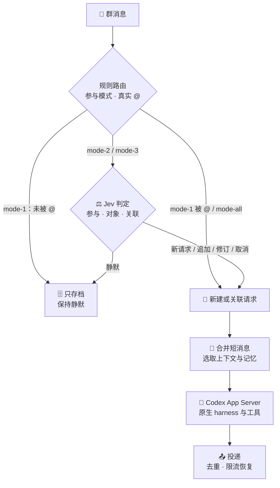
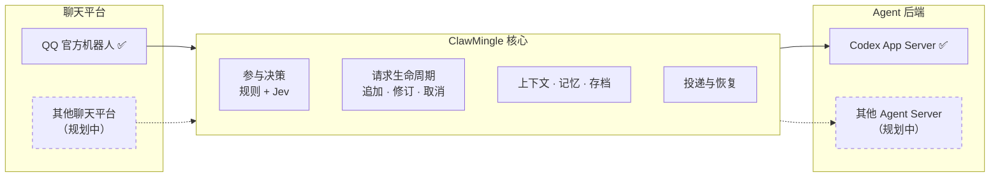

<div align="center">


<p>
  <a href="LICENSE"></a>
  
  
  
  
  
</p>

<p>
  <b>简体中文</b> · <a href="README_en.md">English</a>
</p>

<p>
  <a href="#-快速开始">快速开始</a> ·
  <a href="#-工作原理">工作原理</a> ·
  <a href="#-功能一览">功能</a> ·
  <a href="#-与上游-codexclaw-的区别">与上游的区别</a> ·
  <a href="#-文档">文档</a> ·
  <a href="#%EF%B8%8F-路线图">路线图</a>
</p>

</div>

> **ClawMingle** 是一个参与多人群聊的 AI 群友。它先用低成本的 **Jev** 模型判断哪些消息需要回应，只在需要时才唤起完整的 Agent（目前是 **Codex App Server**）来回复或执行任务，并保留 Codex 原生的 harness 与工具调用能力。

<br>

## 💡 为什么做 ClawMingle

大多数聊天机器人只有两种做法：**被 @ 才回**（冷冰冰、错过上下文），或者**每条都回**（话多、打扰人，而且很贵）。

真实的群聊里，多人同时说话，绝大多数消息是闲聊、表情、附和，和机器人无关。如果每条消息都交给昂贵的 Agent 读一遍、想一遍，成本会随群活跃度线性增长，回复也会变得啰嗦。

ClawMingle 的做法是**把"要不要说话"和"说什么"分开**：

| 环节 | 交给谁 | 特点 |
| :--- | :--- | :--- |
| 要不要参与、回应谁、是否在补充已有请求 | **Jev**，低成本判定模型 | 快、便宜，只输出结构化判断 |
| 回复内容、多步任务、工具调用 | **Agent**，目前是 Codex App Server | 能力完整，只在需要时调用 |
| 合并连续短消息、选取上下文与记忆、投递、限流恢复 | **应用本身** | 确定性规则，不消耗模型调用 |

被判为不需要回应的消息只进入本地存档，不会唤起 Agent。

<br>

## 🧭 工作原理



每个群可以单独选择参与模式：

| 模式 | 行为 | 是否调用 Jev |
| :--- | :--- | :---: |
| `mode-1` | 只在被真实 @ 时回应，其余消息保留为上下文 | 否 |
| `mode-2` | 关注求助，以及明确或隐含对机器人说的话 | 是 |
| `mode-3` | 也会参与日常分享、情绪和共同话题，像一位群友 | 是 |
| `mode-all` | 每条有效消息都回应 | 否 |

在 `mode-2` 和 `mode-3` 中被 @ 时一定会回应，Jev 只负责判断这条消息是新请求，还是在追加、修订或取消已有请求。只引用机器人的消息不等于 @。详细规则见[群聊运行说明](docs/social-pilot.md)。

<br>

## 🎯 功能一览

<table>
<tr>
<td width="50%" valign="top">

### 🧠 群聊参与决策
- 四种参与模式，每个群单独设置
- Jev 判断是否参与、回应谁、用什么风格
- 识别对已有请求的**追加、修订、取消**，支持多人补充，修改权限按真实发送者校验
- 连续短消息先等待安静窗口再合并，积压的短回复可共享一次 Agent 调用

</td>
<td width="50%" valign="top">

### 💬 对话与长任务
- 长任务先简短确认，再按真实进展反馈，缺少信息时主动澄清
- 执行中收到的补充通过原生 `turn/steer` 追加给正在运行的 Agent
- 用 `/status` 查询任务进度与投递状态
- 投递结果分为已送达、未发送、未知三种，结果未知时不盲目重发

</td>
</tr>
<tr>
<td valign="top">

### 🪪 人格与记忆
- 全局共享的 **Identity**（身份）与 **Soul**（性格），每个群另有独立档案
- 分类记忆：自动提取的内容先进入草稿，**归档后才作为事实使用**
- 每日自动整理记忆，群聊、私聊、不同会话之间相互隔离
- 收到的全部消息存入本地 SQLite，可按消息检索

</td>
<td valign="top">

### 🖼️ 图片与语音
- 理解群成员发送的图片（每轮最多 3 张）
- 使用机器人自己的 Codex 账号**生成和修改图片**，无需另配图片 API
- 读取 QQ 平台提供的语音转写
- 可以把会话中的图片原样发回

</td>
</tr>
<tr>
<td valign="top">

### 😄 表情包
- 所有群聊和私聊共用一个表情库，自动收集并生成语义描述
- 按会话记录表情偏好：近 14 天、最近 100 次、连续使用分数
- 可单独开关自动收集和自动使用，在管理台批量导入、分类、设偏爱或禁用

</td>
<td valign="top">

### 📄 群文档与文件
- 通过腾讯文档官方 MCP 管理群计划、清单和表格
- 只能访问为本群绑定的专用目录，每次操作都重新核验
- 支持 QQ 原生群文件交付

</td>
</tr>
<tr>
<td valign="top">

### 🛠️ 工具与扩展
- 基于 **Bubblewrap** 的隔离工作区，机器人使用独立认证，不读取个人 Codex 配置
- Playwright 浏览器默认关闭，需按会话授权
- 可从 GitHub 安装 Skill：固定提交版本并逐个校验文件哈希，不执行安装脚本
- 支持按会话的定时任务和第三方扩展能力

</td>
<td valign="top">

### 🖥️ 轻量管理台
- 只在本机监听，远程用 SSH 隧道访问，自带登录与**首次设置向导**
- 在网页中配置 QQ、Jev、模型，完成 Codex 设备登录和群登记
- 管理人格、记忆、表情、技能、工具授权、服务启停与备份
- 密钥只写不回显

</td>
</tr>
</table>

<br>

## 🆚 与上游 CodexClaw 的区别

ClawMingle 基于 [CodexClaw](https://github.com/Rhapsody0x1/CodexClaw) 的 Rust 底座继续开发，保留了它的 QQ 接入、Codex App Server 客户端和模块结构，但产品方向不同：

| | CodexClaw（上游） | ClawMingle |
| :--- | :--- | :--- |
| **定位** | 个人私聊助理，通过 QQ 操作自己电脑上的 Codex | 多人群聊中的 AI 群友 |
| **消息处理** | 消息逐条交给 Codex | 规则加 Jev 低成本筛选，按需唤起 Agent |
| **请求模型** | 一问一答 | 请求有版本，支持追加、修订、取消和多人补充 |
| **认证与环境** | 可导入个人 Codex 会话 | 机器人独立认证，使用隔离工作区，工具按会话授权 |
| **记忆** | 单个用户的记忆蒸馏 | 按群隔离的分类记忆，草稿归档后才使用，配合完整存档 |
| **群聊能力** | — | 表情库、群文档、图片生成、长任务反馈 |
| **管理方式** | QQ 命令与 CLI | 另有本机 Web 管理台、首次设置向导和安装器 |

<br>

## 🧩 架构与扩展方向



项目的核心价值在中间层：**低成本的参与决策，加上群聊场景下的请求、上下文和投递管理**。

目前聊天平台只接入了 QQ 官方机器人，Agent 后端只接入了 Codex App Server，两者都直接写在代码里，还没有抽象成可替换的适配层。选择 Codex App Server 是为了保留 Codex 原生的 harness、工具调用和执行环境。

后续计划把聊天平台和 Agent 后端都抽象成适配接口，以便接入其他聊天软件和其他 Agent Server（例如 GLM 的 Z Code）。这是规划方向，尚未实现。

<br>

## 🚀 快速开始

### 准备

- 一台 Linux 机器，需要 systemd 用户服务、非特权 Bubblewrap、Python 3.11+、Rust/Cargo 和原生 Codex
- 在 [QQ 开放平台](https://q.qq.com/)创建的官方机器人（AppID、AppSecret）和一个测试群
- 机器人自己的 Codex 登录，或兼容 Responses 协议的模型服务
- *可选*：Jev API Key，`mode-2` 和 `mode-3` 需要。只用 `mode-1` 时可以不填

所有密钥都在管理台网页中填写，**不需要发给任何人，也不需要发给 Agent**。

### 方式 A：交给编程 Agent 部署（推荐）

把下面这段话发给一个能操作目标机器的编程 Agent（例如 Codex 或 Claude Code）：

> 请在这台 Linux 机器部署 ClawMingle，仓库是 https://github.com/YYYYYangjijjia/ClawMingle 。先读仓库指导和 docs/agent-deployment.md，检查依赖与已有安装，按手册完成构建、安装和验证。管理台只允许本机或 SSH 隧道访问。QQ 密钥和机器人账号由我在网页配置；不要复用个人 Codex 的认证或历史。首次配置完成前只准备管理台，配置和登录完成后再启动机器人。保留已有数据，并说明验证结果与回滚方式。

Agent 会按 [Agent 部署手册](docs/agent-deployment.md)完成预检、构建、安装和验证。

### 方式 B：手动安装

```sh
git clone https://github.com/YYYYYangjijjia/ClawMingle.git && cd ClawMingle

# 1. 只读预检：列出缺少的依赖和将要写入的位置，不改动任何东西
python3 -B scripts/install_clawmingle.py --plan --build

# 2. 构建并安装到 ~/.local/lib/clawmingle，然后启动管理台（不会启动机器人）
python3 -B scripts/install_clawmingle.py --apply --build --start-admin
```

### 在网页中完成首次设置

1. 打开 `http://127.0.0.1:17430/`。远程机器先在自己的电脑上执行 `ssh -N -L 17430:127.0.0.1:17430 YOUR_USER@YOUR_HOST`
2. 在自己的终端读取 `~/.config/clawmingle/admin-bootstrap.json` 中的配对码，用它设置管理员密码
3. 填写 QQ 凭据、Jev Key（可选）和模型
4. 点击群登记，在测试群里 @ 机器人并发送页面上显示的一次性口令
5. 在管理台完成机器人的 Codex 设备登录，然后启动机器人：

```sh
systemctl --user start clawmingle.service
```

在测试群 @ 机器人问一个简单问题，收到回复即部署成功。首次设置默认使用 `mode-1`，关闭私聊和浏览器，可以随时在管理台调整。遇到问题请看[部署说明中的常见问题](docs/deploy.md#常见问题)。

<br>

## 📚 文档

| 我想… | 文档 |
| :--- | :--- |
| 了解需要准备什么、怎么部署 | [用户部署说明](docs/deploy.md) |
| 让 Agent 安装、验证、升级 | [Agent 部署手册](docs/agent-deployment.md) |
| 使用管理台 | [管理台](docs/admin.md) |
| 了解参与模式、命令和群聊行为 | [群聊运行说明](docs/social-pilot.md) |
| 了解上下文、存档和消息合并 | [消息与上下文](docs/message-context.md) |
| 使用记忆、长任务、表情、群文档 | [记忆](docs/memory.md) · [长任务](docs/long-tasks.md) · [表情](docs/stickers.md) · [群文档](docs/group-documents.md) |
| 配置隔离环境与扩展 | [运行环境](docs/native-runtime.md) · [浏览器](docs/native-browser.md) · [扩展授权](docs/scoped-integrations.md) · [技能包](docs/skill-packages.md) |
| 备份与恢复 | [聊天历史备份](docs/backups.md) |
| 理解代码结构、参与开发 | [架构](docs/architecture.md) · [开发约定](docs/development.md) · [贡献指南](CONTRIBUTING.md) |

详细文档目前以中文为主。[设计记录](docs/continuation-design.md)保存历史决策过程，日常使用请以上面的操作文档为准。

<br>

## ⚠️ 当前局限

ClawMingle 仍处于早期开发阶段，下面这些情况请提前了解：

- **只在小规模测试群中验证过**，Jev 判断的准确率还没有系统评估，真实效果需要在你自己的群里验证。
- `mode-2` 和 `mode-3` 依赖 QQ 机器人拥有接收群内全部消息的权限。如果只能收到 @ 事件，切换模式也看不到其他消息。
- **表情互动还不理想**：AI 很少主动发表情。成员单独发一个表情时，Jev 通常判断为不需要回应，所以表情往往得不到回应。
- 语音只使用 QQ 平台提供的转写文本，不下载原始音频，也不支持语音回复。
- 目前只支持 Linux、QQ 和 Codex App Server。安装器只负责新安装，升级需要按手册手动操作。
- 管理台按单个管理员、本机访问设计，不提供公网托管或多账号管理。

<br>

## 🗺️ 路线图

- [x] 群聊参与决策（规则加 Jev）与请求的追加、修订、取消
- [x] 分类记忆、群档案、完整聊天存档与备份
- [x] 图片理解与生成、语音转写、表情库、腾讯文档
- [x] 本机管理台、首次设置向导与安装器
- [ ] 系统评估并调优 Jev 判断质量
- [ ] 更主动、更贴切地使用表情，改进对表情消息的参与判断
- [ ] 安装器支持原地升级
- [ ] 聊天平台适配层，接入 QQ 以外的平台
- [ ] Agent 后端适配层，接入 Codex App Server 以外的 Agent Server
- [ ] 完整的英文文档

<br>

## 🔒 隐私与安全

- **独立身份**：机器人使用自己的 Codex 登录和运行目录，不读取、不复制你个人的 Codex 配置、认证或历史。
- **本地存档**：机器人收到的所有消息都会保存在本地私有存档中，包括它没有回复的消息。压缩上下文或重置会话**不会**删除存档。
- **数据位置**：配置和凭据在 `~/.config/clawmingle/`（权限 `0700`/`0600`），聊天、记忆和工作区在 `~/.local/share/clawmingle/`，这些都不应提交到 Git。
- **共享工作区**：同一个群的成员共用该群的工作区，不能把它当作成员之间的私密空间。
- **管理台**：只监听 `127.0.0.1`，请勿直接暴露到公网。

<br>

## 🤝 参与贡献

欢迎提交 Issue 和 Pull Request。开始之前请先阅读[贡献指南](CONTRIBUTING.md)和[开发约定](docs/development.md)。提交前需要通过 `cargo fmt`、`cargo clippy`（0 警告）、`cargo test` 和仓库的敏感数据检查。

<br>

## 🙏 致谢与许可

- 本项目基于 [**CodexClaw**](https://github.com/Rhapsody0x1/CodexClaw)（作者 Rhapsody0x1）开发，沿用其 MIT 许可并保留原作者署名。上游 README 完整存档在 [docs/upstream/](docs/upstream/README.md)。其中的个人会话导入和 `codex-claw` 部署步骤属于上游产品，不适用于 ClawMingle。
- Agent 能力由 [OpenAI Codex](https://developers.openai.com/codex/app-server) App Server 提供，浏览器能力来自 [Playwright](https://playwright.dev/)。
- 以 [MIT License](LICENSE) 发布。

<div align="center">
<br>
<sub>如果 ClawMingle 对你有帮助，欢迎点一个 ⭐</sub>
</div>
