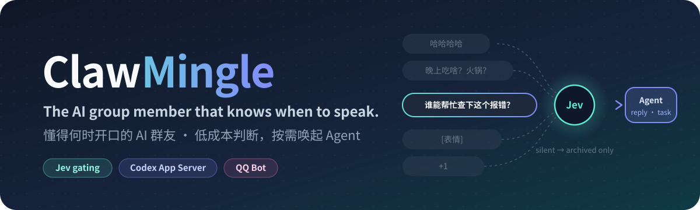
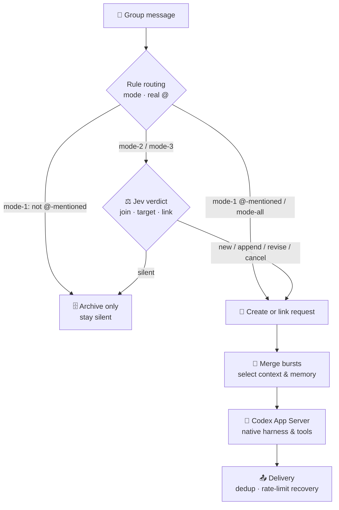
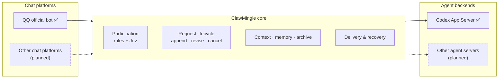

<div align="center">



<p>
  <a href="LICENSE"></a>
  
  
  
  
  
</p>

<p>
  <a href="README.md">简体中文</a> · <b>English</b>
</p>

<p>
  <a href="#-quick-start">Quick start</a> ·
  <a href="#-how-it-works">How it works</a> ·
  <a href="#-features">Features</a> ·
  <a href="#-compared-with-upstream-codexclaw">vs. upstream</a> ·
  <a href="#-documentation">Docs</a> ·
  <a href="#%EF%B8%8F-roadmap">Roadmap</a>
</p>

</div>

> **ClawMingle** is an AI participant for multi-person group chats. A low-cost **Jev** model first decides which messages need a response. Only those messages reach the full agent (currently the **Codex App Server**), which replies or runs the task with Codex's native harness and tool-calling intact.

<br>

## 💡 Why ClawMingle

Most chat bots take one of two approaches. Some **reply only when @-mentioned**: they come across as cold and miss the context. Others **reply to everything**: they talk too much, get in the way, and cost a lot.

In a real group chat several people talk at once, and most messages are banter, stickers or quick reactions that have nothing to do with the bot. If an expensive agent has to read and reason about every one of them, cost rises with group activity and replies get noisy.

ClawMingle **separates deciding *whether* to speak from deciding *what* to say**:

| Step | Handled by | Why |
| :--- | :--- | :--- |
| Whether to join in, whom to address, whether a message adds to an open request | **Jev**, a low-cost judge model | Fast and cheap; returns a structured verdict only |
| Reply content, multi-step tasks, tool calls | **The agent**, currently Codex App Server | Fully capable; invoked only when needed |
| Merging bursts of short messages, choosing context and memory, delivery, rate-limit recovery | **The application** | Orchestration and rule checks, with model calls as needed for backlog review, batched replies, and memory maintenance |

Messages judged not to need a reply remain in the local archive without triggering an immediate reply of their own. They can still contribute to later conversation context and memory maintenance.

<br>

## 🧭 How it works



Each group chooses its own participation mode:

| Mode | Behavior | Calls Jev |
| :--- | :--- | :---: |
| `mode-1` | Replies only to a real @-mention; other messages are kept as context | No |
| `mode-2` | Watches for requests for help and for messages addressed to the bot, explicitly or implicitly | Yes |
| `mode-3` | Also joins everyday sharing, emotions and shared topics, like a regular member | Yes |
| `mode-all` | Replies to every valid message | No |

In `mode-2` and `mode-3`, a real @-mention always gets a reply; Jev only decides whether the message starts a new request or appends to, revises or cancels an existing one. Quoting the bot is not the same as an @-mention. See the [group chat guide](docs/social-pilot.md) (Chinese) for the full rules.

<br>

## 🎯 Features

<table>
<tr>
<td width="50%" valign="top">

### 🧠 Participation decisions
- Four participation modes, set per group
- Jev decides whether to join in, whom to address and which style to use
- Recognizes **appends, revisions and cancellations** of open requests and accepts contributions from several members; permission to change a request is checked against the real sender
- Bursts of short messages are merged after a quiet window; backlogged short replies can share a single agent call

</td>
<td width="50%" valign="top">

### 💬 Conversations & long tasks
- Long tasks get a short acknowledgement, then progress updates based on real progress, and a clarifying question when information is missing
- Follow-ups sent during execution reach the running agent through native `turn/steer`
- `/status` shows task progress and delivery state
- Each delivery is recorded as sent, not sent or unknown; unknown results are never blindly re-sent

</td>
</tr>
<tr>
<td valign="top">

### 🪪 Persona & memory
- A shared **Identity** and **Soul** for the bot, plus a separate profile for each group
- Categorized memory: extracted items start as drafts and are **used as facts only after they are filed**
- Memory is consolidated automatically every day; groups, private chats and sessions are isolated from each other
- Every received message is archived in a local SQLite database and can be searched by message

</td>
<td valign="top">

### 🖼️ Images & voice
- Understands images that members send (up to 3 per turn)
- **Generates and edits images** with the bot's own Codex account; no separate image API needed
- Reads the voice transcripts that the QQ platform provides
- Can send images from the conversation back unchanged

</td>
</tr>
<tr>
<td valign="top">

### 😄 Stickers
- One sticker library shared by all group and private chats, with automatic collection and semantic descriptions
- Tracks sticker preferences per conversation: the last 14 days, the last 100 uses, and a streak score
- Auto-collection and auto-use can be switched on or off separately; the admin UI supports bulk import, categories, favorites and disabling

</td>
<td valign="top">

### 📄 Group documents & files
- Manages group plans, checklists and spreadsheets through the official Tencent Docs MCP
- Access is limited to the folder bound to that group and is re-checked on every operation
- Delivers files through QQ's native group files

</td>
</tr>
<tr>
<td valign="top">

### 🛠️ Tools & extensions
- An isolated workspace based on **Bubblewrap**; the bot uses its own credentials and never reads your personal Codex configuration
- The Playwright browser is off by default and must be granted per conversation
- Installs Skills from GitHub, pinned to a commit with every file hash verified; install scripts are never run
- Supports scheduled tasks and third-party extensions, granted per conversation

</td>
<td valign="top">

### 🖥️ Lightweight admin UI
- Listens on localhost only (use an SSH tunnel for remote access), with its own login and a **first-run setup wizard**
- Configure QQ, Jev and the model in the browser, complete Codex device login and register groups
- Manage persona, memory, stickers, skills, tool grants, service start/stop and backups
- Secrets are write-only and never shown again

</td>
</tr>
</table>

<br>

## 🆚 Compared with upstream CodexClaw

ClawMingle builds on the Rust foundation of [CodexClaw](https://github.com/Rhapsody0x1/CodexClaw). It keeps the QQ integration, the Codex App Server client and the module structure, but aims at a different product:

| | CodexClaw (upstream) | ClawMingle |
| :--- | :--- | :--- |
| **Purpose** | Personal assistant in private chat: drive the Codex on your own computer through QQ | AI participant in multi-person group chats |
| **Message handling** | Every message goes to Codex | Rules plus low-cost Jev filtering; the agent runs only when needed |
| **Request model** | One question, one answer | Versioned requests with append, revise, cancel and multi-member contributions |
| **Auth & environment** | Can import your personal Codex session | Separate bot credentials, an isolated workspace, tools granted per conversation |
| **Memory** | Memory distillation for a single user | Categorized memory isolated per group; drafts are used only after filing; full archive |
| **Group features** | — | Sticker library, group documents, image generation, long-task updates |
| **Administration** | QQ commands and CLI | Adds a local web admin UI, a first-run setup wizard and an installer |

<br>

## 🧩 Architecture & direction



The project's main value is the middle layer: **low-cost participation decisions, plus request, context and delivery management built for group chat**.

Today the only chat platform is the official QQ bot and the only agent backend is the Codex App Server. Both are wired directly into the code and are not yet behind swappable adapters. We chose the Codex App Server to keep Codex's native harness, tool calling and execution environment.

The plan is to turn chat platforms and agent backends into adapter interfaces so that other chat apps and other agent servers (for example GLM's Z Code) can be added. This is a direction, not a current feature.

<br>

## 🚀 Quick start

### Prerequisites

- A Linux machine with systemd user services, unprivileged Bubblewrap, Python 3.11+, Rust/Cargo and native Codex
- An official bot created on the [QQ Open Platform](https://q.qq.com/) (AppID and AppSecret) and a test group
- The bot's own Codex login, or a model service compatible with the Responses API
- *Optional*: a Jev API key, required for `mode-2` and `mode-3`. You can skip it if you only use `mode-1`

You enter every secret in the admin web UI. **Never send secrets to anyone, including an agent.**

### Option A: let a coding agent deploy it (recommended)

Give a coding agent that can operate the target machine (for example Codex or Claude Code) the following instruction:

> Deploy ClawMingle on this Linux machine from https://github.com/YYYYYangjijjia/ClawMingle . Read the repository guidance and docs/agent-deployment.md first, check dependencies and any existing installation, then build, install and verify according to the runbook. The admin UI must only be reachable from localhost or an SSH tunnel. I will enter the QQ secrets and bot account in the web UI; do not reuse my personal Codex credentials or history. Prepare only the admin UI until initial setup is done, and start the bot only after configuration and login are complete. Preserve existing data and report the verification results and how to roll back.

The agent follows the [agent deployment runbook](docs/agent-deployment.md) (Chinese) to run preflight checks, build, install and verify.

### Option B: install manually

```sh
git clone https://github.com/YYYYYangjijjia/ClawMingle.git && cd ClawMingle

# 1. Read-only preflight: lists missing dependencies and target locations; changes nothing
python3 -B scripts/install_clawmingle.py --plan --build

# 2. Build, install into ~/.local/lib/clawmingle, and start the admin UI (not the bot)
python3 -B scripts/install_clawmingle.py --apply --build --start-admin
```

### Finish setup in the browser

1. Open `http://127.0.0.1:17430/`. For a remote machine, first run `ssh -N -L 17430:127.0.0.1:17430 YOUR_USER@YOUR_HOST` on your own computer
2. In your own terminal, read the pairing code from `~/.config/clawmingle/admin-bootstrap.json` and use it to set the admin password
3. Enter your QQ credentials, the optional Jev key and the model
4. Click group registration, then @-mention the bot in your test group with the one-time code shown on the page
5. Complete the bot's Codex device login in the admin UI, then start the bot:

```sh
systemctl --user start clawmingle.service
```

@-mention the bot in the test group with a simple question. If it replies, the deployment works. Initial setup defaults to `mode-1` with private chat and the browser turned off; you can change any of this in the admin UI. If something goes wrong, see the [FAQ in the deployment guide](docs/deploy.md#常见问题) (Chinese).

<br>

## 📚 Documentation

Detailed documentation is currently in Chinese.

| I want to… | Document |
| :--- | :--- |
| Know what to prepare and how to deploy | [Deployment guide](docs/deploy.md) |
| Have an agent install, verify or upgrade | [Agent deployment runbook](docs/agent-deployment.md) |
| Use the admin UI | [Admin UI](docs/admin.md) |
| Understand modes, commands and chat behavior | [Group chat guide](docs/social-pilot.md) |
| Understand context, archiving and message merging | [Messages & context](docs/message-context.md) |
| Use memory, long tasks, stickers, group documents | [Memory](docs/memory.md) · [Long tasks](docs/long-tasks.md) · [Stickers](docs/stickers.md) · [Group documents](docs/group-documents.md) |
| Configure isolation and extensions | [Native runtime](docs/native-runtime.md) · [Browser](docs/native-browser.md) · [Scoped integrations](docs/scoped-integrations.md) · [Skill packages](docs/skill-packages.md) |
| Back up and restore | [Chat history backups](docs/backups.md) |
| Understand the code and contribute | [Architecture](docs/architecture.md) (Chinese) · [Development](docs/development.md) · [Contributing](CONTRIBUTING_en.md) |

The [design record](docs/continuation-design.md) keeps the history of past decisions; for day-to-day use, follow the operational docs above.

<br>

## ⚠️ Current limitations

ClawMingle is in early development. Please be aware of the following before you deploy it:

- **It has only been tested in small test groups**, and Jev's accuracy has not been formally evaluated. Check how it behaves in your own groups.
- `mode-2` and `mode-3` require the QQ bot to have permission to receive all group messages. If the bot only receives @-mention events, switching modes will not let it see other messages.
- **Sticker interaction is still weak**: the bot rarely sends stickers on its own initiative. When a member posts just a sticker, Jev usually judges that no reply is needed, so stickers often go unanswered.
- Voice support uses only the transcript provided by the QQ platform. Raw audio is not downloaded, and the bot cannot reply with voice.
- Only Linux, QQ and the Codex App Server are supported. The installer handles fresh installs only; upgrades follow the runbook by hand.
- The admin UI is designed for a single administrator on localhost. It does not support public hosting or multiple accounts.

<br>

## 🗺️ Roadmap

- [x] Group participation decisions (rules plus Jev) with request append, revise and cancel
- [x] Categorized memory, group profiles, full chat archive and backups
- [x] Image understanding and generation, voice transcripts, sticker library, Tencent Docs
- [x] Local admin UI, first-run setup wizard and installer
- [ ] Evaluate and tune Jev's judgment quality
- [ ] Use stickers more proactively and aptly, and judge sticker messages better
- [ ] In-place upgrades in the installer
- [ ] A chat-platform adapter layer for platforms beyond QQ
- [ ] An agent-backend adapter layer for agent servers beyond the Codex App Server
- [ ] Full English documentation

<br>

## 🔒 Privacy & security

- **Separate identity**: the bot uses its own Codex login and runtime directory. It never reads or copies your personal Codex configuration, credentials or history.
- **Local archive**: every message the bot receives is stored in a private local archive, including messages it did not reply to. Compacting context or resetting a session does **not** delete the archive.
- **Data locations**: configuration and credentials live in `~/.config/clawmingle/` (permissions `0700`/`0600`); chats, memory and workspaces live in `~/.local/share/clawmingle/`. Keep all of it out of Git.
- **Shared workspace**: members of the same group share that group's workspace, so do not treat it as private between members.
- **Admin UI**: it listens on `127.0.0.1` only. Do not expose it to the public internet.

<br>

## 🤝 Contributing

Issues and pull requests are welcome. Read the [contributing guide](CONTRIBUTING_en.md) and the [development conventions](docs/development.md) first. Before you submit, `cargo fmt`, `cargo clippy` (zero warnings), `cargo test` and the repository's sensitive-data check must all pass.

<br>

## 🙏 Acknowledgements & license

- ClawMingle is built on [**CodexClaw**](https://github.com/Rhapsody0x1/CodexClaw) by Rhapsody0x1 and keeps its MIT license and attribution. The upstream README is archived in [docs/upstream/](docs/upstream/README_en.md). Its personal-session import and `codex-claw` deployment steps belong to the upstream product and do not apply to ClawMingle.
- Agent capabilities come from the [OpenAI Codex](https://developers.openai.com/codex/app-server) App Server, and browser capabilities from [Playwright](https://playwright.dev/).
- Development is led by the maintainer, primarily with [Codex](https://github.com/codex) assisting with implementation, debugging and code review. [Claude Code](https://github.com/anthropics/claude-code) has also helped organize and refine the documentation. The maintainer owns design decisions, validation and releases; commit co-author trailers credit the AI tools actually used.
- Released under the [MIT License](LICENSE).

<div align="center">
<br>
<sub>If ClawMingle is useful to you, a ⭐ is appreciated.</sub>
</div>
